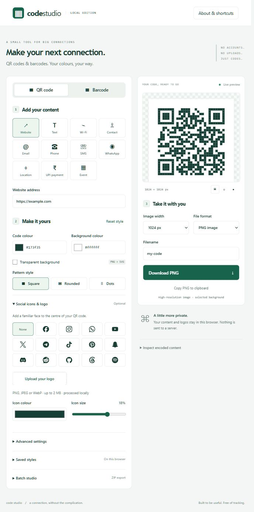
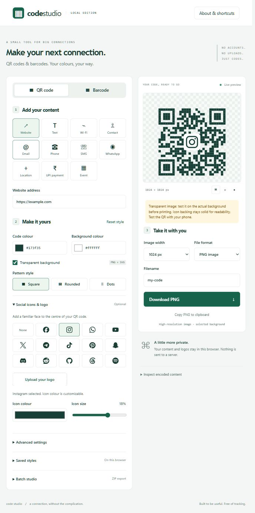
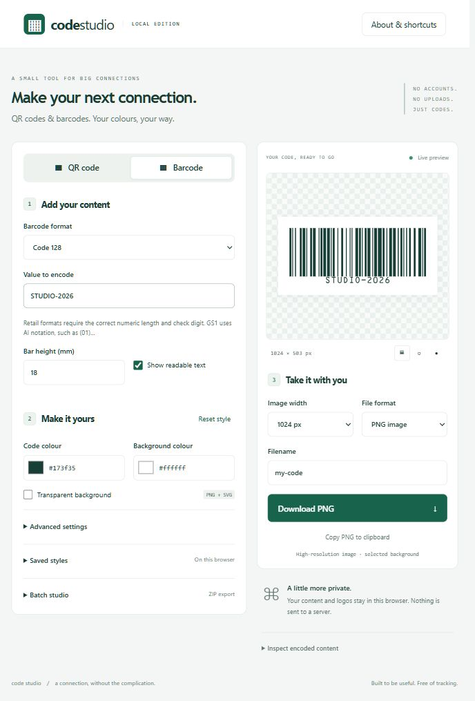

# Code Studio

A lightweight browser-only QR code and barcode maker. All encoding, logo processing, PNG/SVG export and batch ZIP creation happen locally. No account, API key, backend, analytics or paid service.

## Run

Requires Node.js 20.19+ or 22.12+ (Node 24 recommended).

```sh
npm install
npm run dev
```

Open the localhost URL printed by Vite. Production: `npm run build`; serve `dist/` on any static HTTPS host. `npm run preview` previews the production build locally. Clipboard export requires a secure context (HTTPS or localhost) and browser permission.

## Available now

- QR content: URL, text, Wi-Fi, vCard contact, email, phone, SMS, WhatsApp, geographic coordinates, UPI and calendar event.
- Barcode formats: Code 128/39/93, EAN-13/8, UPC-A/E, ITF/ITF-14, Codabar, GS1-128, Data Matrix, PDF417, Aztec.
- Live preview, input errors, encoded-content inspection and contrast guidance.
- Foreground/background colours, transparent background, square/rounded/dot QR modules, quiet zone, QR correction level, captions, barcode height/readable text.
- Facebook, Instagram, WhatsApp, YouTube, X, Telegram, TikTok, Pinterest, Snapchat, Discord, Reddit, GitHub, Threads, Spotify icons; adjustable colour/size; custom PNG/JPEG/WebP logo upload.
- PNG, SVG, WebP and JPEG downloads at 256–4096 px width. SVG is resolution independent. JPEG uses a solid background. Copy PNG where supported.
- Saved local styles (no content or uploaded logos), style JSON import/export.
- Batch raw values/CSV to PNG ZIP, cancellation, per-row errors, unique filenames. Up to 200 items; batch width capped at 2048 px to limit memory use.
- Responsive layout, keyboard controls, native accessible inputs, reduced-motion and high-contrast support.

## Documentation

- [Product plan and full roadmap](docs/PRODUCT.md)
- [Architecture and operational notes](docs/ARCHITECTURE.md)
- [Design decisions](DESIGN.md)
- [Interaction contract](UX-CONTRACT.md)

## Checks

`npm test` runs payload, validation, CSV parsing and SVG generation tests. `npm run build` checks TypeScript and builds the production bundle.

## Important behavior

Static QR codes cannot change destination after printing. Specialized content depends on the reader app; test with your actual devices. Retail identifiers must be legitimately assigned separately. A decoder check or a visually attractive preview cannot guarantee physical scanning. Transparent backgrounds require sufficient contrast at their final placement. Logos have a solid backing plate even in otherwise transparent exports. Use a short caption to avoid clipping. Style JSON deliberately excludes content, uploaded logos and captions. No content is saved automatically.

## Brand assets

Icons are sourced from Simple Icons. Logos and names remain the property of their respective owners; review individual brand guidelines before public/commercial use. No endorsement is implied. See the installed `simple-icons` package for its license and asset metadata.

## Screenshots

Captured from the local app on 25 October 2026 using example content.

### QR workspace



### Social branding and transparency

Select a social icon, adjust its colour and size, and export with a transparent background. The checkerboard is preview-only and is not baked into downloads.



### Barcode workspace



## How to use

1. Choose **QR code** or **Barcode**.
2. For a QR code, choose a content type and complete its fields. For a barcode, choose a format and enter a compatible value.
3. Customize colours and background. QR codes also support module patterns, social icons and uploaded logos.
4. Review the live preview and warnings. **Inspect encoded content** shows the exact payload.
5. Choose image width, file format and filename, then select **Download**. Ctrl/Cmd + Enter also downloads the current code.
6. Test the exported code with the devices and background you intend to use.

Use **Saved styles** to save settings on this browser or import/export style JSON. Saving another style with the same name replaces it. Saved styles exclude content, captions and uploaded logos.

## Batch export

Open **Batch studio**. Paste one raw value per line, or import CSV using this header:

```csv
value,filename
https://example.com,website
https://instagram.com/example,instagram
"Text containing a comma, like this",message
```

Batch QR values are encoded directly; the selected QR content form is not applied. Barcode batches use the selected barcode format. Downloaded ZIP files contain uniquely numbered PNGs and an `errors.txt` file when some rows fail. Cancellation discards the unfinished batch. Batch export currently supports up to 200 items at a maximum width of 2048 px.

## Tech stack

| Layer | Choice |
| --- | --- |
| UI and tooling | Vanilla TypeScript, Vite, plain CSS |
| QR encoding | qrcode module matrix with a local SVG renderer |
| Barcodes | bwip-js, loaded on demand |
| Social icons | Curated Simple Icons paths, bundled locally |
| Images | Native SVG, Canvas, Blob and File APIs |
| Batch archive | fflate, loaded on demand |
| Persistence | Explicit localStorage style saves |
| Hosting | Static files; no backend required |

The production entry JavaScript is approximately 22 KB gzipped in the verified build. Social icons and batch ZIP support are separate chunks; the broad barcode engine is approximately 263 KB gzipped and loads when needed. Exact sizes can change with dependencies and builds.

## Development commands

| Command | Purpose |
| --- | --- |
| `npm ci` | Install exact dependencies from the committed lockfile |
| `npm run dev` | Start the local development server |
| `npm test` | Run the nine payload and generator tests |
| `npm run build` | Type-check and create `dist/` |
| `npm run preview` | Serve the production build locally |

Use a current Chrome, Edge, Firefox or Safari browser. Clipboard image support varies by browser and permissions. If copying fails, download PNG instead. If port 5173 is busy, use the local URL printed by Vite. Opening `index.html` directly from disk is not supported; use a development or static web server.

## Current limits and next steps

This is the initial local release. PDF label sheets, physical print sizing, camera scanning, automatic decode checks, undo/redo, saved projects, dark mode and installable offline support are planned, not implemented. Dynamic destinations and analytics would require a separately scoped backend.

See [the full roadmap](docs/PRODUCT.md), [verification evidence and remaining checks](docs/VERIFICATION.md), and [the screenshot capture notes](docs/SCREENSHOTS.md). There is no public deployment in this repository setup.
